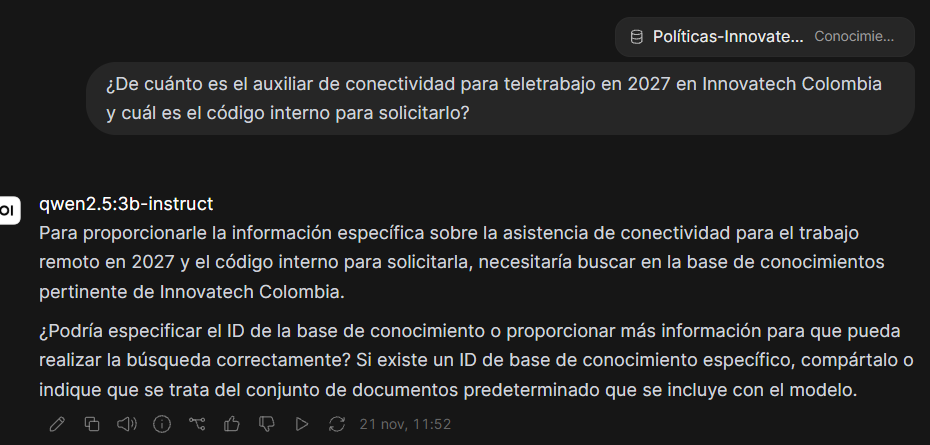
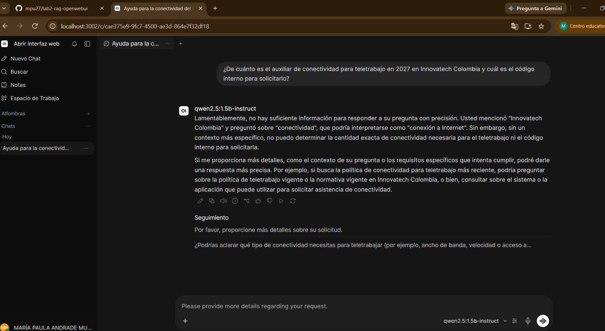
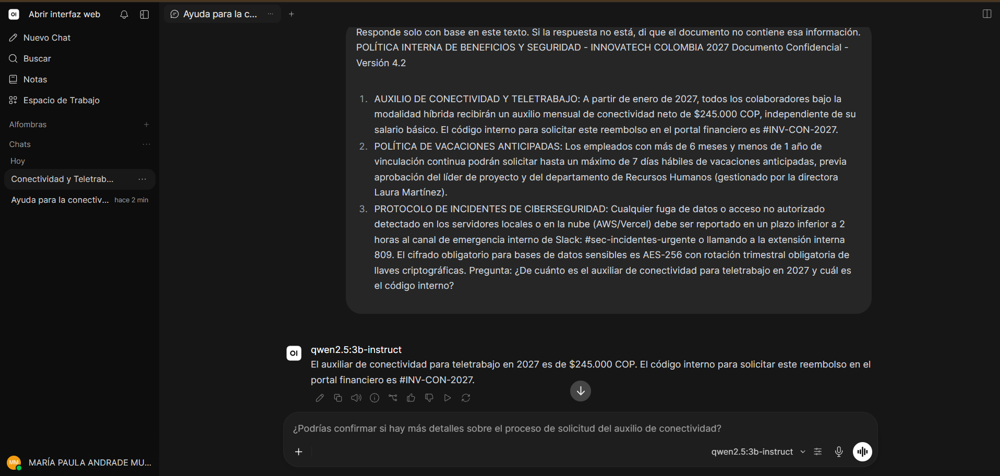
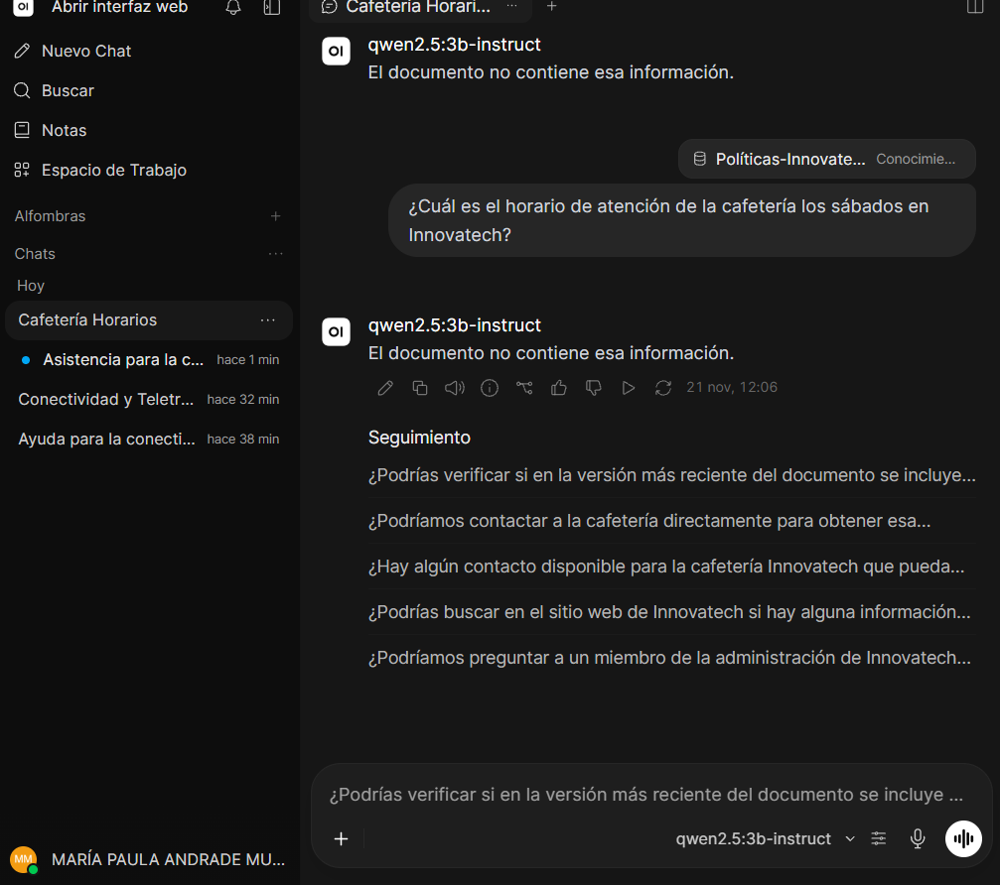

# Lab 2: Pipeline RAG Documental con Open WebUI y Ollama

**Estudiante:** María Paula Andrade Muñoz
**Modelo evaluado:** qwen2.5:3b-instruct + nomic-embed-text (Ollama local, Docker Compose)

## 1. Comportamiento "Antes del RAG"

Sin documento, el modelo (qwen2.5:1.5b-instruct) no conoce la política de Innovatech. No dio el valor del auxilio ni el código interno, y pidió más detalles. No tiene acceso a datos privados.

## 2. Comportamiento "Después del RAG"

Creamos la base de conocimiento `Politicas-Innovatech-2027`, subimos el documento y la adjuntamos con `#`. El modelo no usó el documento (ver "Fallo encontrado").

Para comprobar que el modelo sí puede responder, pegamos el texto del documento directo en el mensaje. Con eso qwen2.5:3b-instruct respondió bien el dato exacto: **$245.000 COP** y **#INV-CON-2027**. Esto no es RAG real, es contexto pegado en el prompt.

### Batería de pruebas (texto en el prompt)

| Prueba                       | Respuesta del modelo                                                             | Resultado                                                                                                        |
| ---------------------------- | -------------------------------------------------------------------------------- | ---------------------------------------------------------------------------------------------------------------- |
| Dato exacto                  | $245.000 COP y #INV-CON-2027                                                     | Correcto                                                                                                         |
| Condicional / Rol            | Dijo que con 8 meses no cumple los requisitos para vacaciones anticipadas        | Incorrecto: con más de 6 meses y menos de 1 año sí aplica (máximo 7 días hábiles, gestionado por Laura Martínez) |
| Protocolo técnico            | Menos de 2 horas, Slack #sec-incidentes-urgente, AES-256 con rotación trimestral | Correcto, no mencionó la ext. 809                                                                                |
| Anti-alucinación (cafetería) | "El documento no contiene información sobre el horario de la cafetería"          | Correcto                                                                                                         |

## 3. Análisis de Prueba Anti-Alucinación

El modelo respetó los límites del contexto. No inventó un horario y dijo que el documento no tiene esa información. Esto se probó con el texto pegado y la instrucción "responde solo con base en este texto".

## 4. Fallo encontrado

Con la base de conocimiento adjunta, el modelo no usó el documento. En vez de responder, pidió el "ID de la base de conocimiento". Con el archivo adjunto pasó algo parecido: el modelo intentaba "buscar" el archivo con una herramienta y la respuesta salía desordenada, sin espacios.

Lo mismo pasó en una instalación anterior del laboratorio. No sabemos la causa exacta; creemos que es una limitación del modelo pequeño (3b) con las herramientas de Open WebUI. Por eso las pruebas se hicieron con el texto pegado.

También hubo un error de contenido: en la prueba condicional el modelo dijo que con 8 meses no se puede pedir vacaciones anticipadas, y el documento dice que sí.

## 5. Otros problemas

- Ollama corta el prompt a unos 2000 tokens por defecto. Lo solucionamos con `OLLAMA_CONTEXT_LENGTH=8192` en `docker-compose.yml`.
- El equipo tiene 3.8 GB de RAM, así que la primera respuesta de cada modelo tarda varios minutos.

## 6. Capturas

